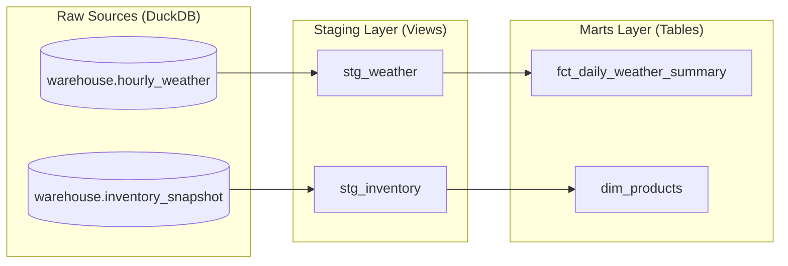

# Analytics Engineering & Star Schema Dimensional Modeling with dbt-core and DuckDB


An analytics engineering transformation layer that turns raw batch and streaming snapshot tables in DuckDB into a Kimball-style star schema. It ships with a dbt test suite for data quality and auto-generated lineage documentation.

---

## Lineage



### Layers

| Layer   | Materialization | Model                       | Purpose |
| ------- | --------------- | --------------------------- | ------- |
| Raw     | Source          | `warehouse.hourly_weather`, `warehouse.inventory_snapshot` | Tables attached from the DuckDB warehouse produced by the upstream pipelines |
| Staging | View            | `stg_weather`               | Casts timestamps and normalizes units: temperature in Celsius, relative humidity, wind speed in km/h |
| Staging | View            | `stg_inventory`             | Enforces primary keys, trims strings, normalizes categories |
| Marts   | Table           | `dim_products`              | Product dimension that classifies inventory health into `In Stock`, `Low Stock`, `Out of Stock` |
| Marts   | Table           | `fct_daily_weather_summary` | Fact table aggregating hourly readings to daily avg/max/min temperature, avg humidity, and total readings |

---

## Key Features & Technical Highlights

- **Kimball dimensional modeling.** Business entities (`dim_products`) are kept separate from measurable events (`fct_daily_weather_summary`), which makes the marts straightforward for BI tools to query.
- **Views for staging, tables for marts.** Staging models are cheap, always-fresh views that hold only light cleaning logic. Marts are materialized as tables so downstream queries read precomputed results instead of re-aggregating hourly data every time. The trade-off is that marts must be rebuilt (`dbt run`) to reflect new raw data.
- **Grain-aware aggregation.** Hourly weather readings are rolled up to a daily grain, which sharply reduces row counts for analytical queries while preserving the reading count per day for transparency.
- **Business logic in one place.** Stock-tier classification lives in `dim_products`, so every consumer sees the same definition of `In Stock`, `Low Stock`, and `Out of Stock`.
- **Declarative data quality.** `unique` and `not_null` tests guard primary keys, and `accepted_values` protects the stock-status categories. Bad data fails the build instead of silently reaching reports.
- **Zero-infrastructure analytics stack.** `dbt-duckdb` runs transformations directly against a local DuckDB file, so the full workflow (build, test, docs) works on a laptop with no warehouse to provision.
- **Visual lineage docs.** `dbt docs` generates an interactive DAG so reviewers can trace any mart column back to its raw source.

---

## Directory Layout

```text
analytics-dbt-duckdb/
├── models/
│   ├── staging/
│   │   ├── schema.yml                   # Sources, descriptions, staging tests
│   │   ├── stg_inventory.sql
│   │   └── stg_weather.sql
│   └── marts/
│       ├── schema.yml                   # Mart descriptions, PK and accepted_values tests
│       ├── dim_products.sql
│       └── fct_daily_weather_summary.sql
├── dbt_project.yml                      # Project config and materializations
├── profiles.yml                         # dbt-duckdb connection profile
├── requirements.txt
└── README.md
```

---

## Quickstart

### Prerequisites

- Python 3.9+ (a version supported by dbt-core 1.8+)
- A DuckDB database containing `hourly_weather` and `inventory_snapshot`, produced by [`local-elt-pipeline`](../local-elt-pipeline) and [`async-cdc-engine`](../async-cdc-engine)

### 1. Clone and create a virtual environment

```bash
git clone https://github.com/<your-username>/analytics-dbt-duckdb.git
cd analytics-dbt-duckdb

python3 -m venv .venv
source .venv/bin/activate        # Windows: .venv\Scripts\activate
pip install --upgrade pip
pip install -r requirements.txt
```

### 2. Point dbt at your warehouse

The project includes a `profiles.yml`. Make sure the DuckDB `path` and the attached source database match where your raw tables live, then tell dbt to use the profile in this directory:

```bash
export DBT_PROFILES_DIR=$(pwd)   # Windows PowerShell: $env:DBT_PROFILES_DIR = (Get-Location)
dbt debug
```

`dbt debug` should report that the connection test passed.

### 3. Build the models

```bash
dbt run
```

### 4. Run the data quality tests

```bash
dbt test
```

Or build and test in dependency order in one step:

```bash
dbt build
```

### 5. Generate and browse the lineage docs

```bash
dbt docs generate
dbt docs serve
```

Open the printed local URL and use the lineage graph icon to explore the DAG.

### 6. Query the star schema

```bash
duckdb <your-database-file>.duckdb
```

```sql
-- Product dimension by stock tier
SELECT stock_status, COUNT(*) AS products
FROM dim_products
GROUP BY stock_status;

-- Latest daily weather summaries
SELECT *
FROM fct_daily_weather_summary
ORDER BY 1 DESC
LIMIT 10;
```

Adjust the schema prefix and column names (such as `stock_status`) to match your models.

---

## Tech Stack

| Layer          | Tool                   |
| -------------- | ---------------------- |
| Transformation | dbt-core 1.8+          |
| Adapter        | dbt-duckdb             |
| Warehouse      | DuckDB                 |
| Modeling       | Kimball star schema    |
| Quality        | dbt tests (`unique`, `not_null`, `accepted_values`) |